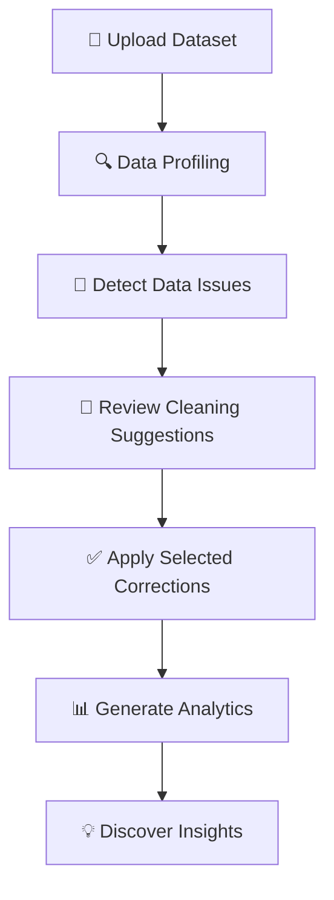

# ⚡ DataAnalysisStudio

\<h3 align="center">🚀 Turning Raw Data Into Powerful Insights\</h3>

\<p align="center">
&#x20; \
\</p>

\<p align="center">
&#x20; \
&#x20; \
&#x20; \
&#x20; \
\</p>

\<p align="center">
&#x20; \
\</p>

## 🌌 About The Project

**DataAnalysisStudio** is a data analysis platform designed to simplify the complete data analysis workflow.

The goal is to help users upload datasets, understand their data, identify data quality issues, clean unwanted values, explore patterns, and generate meaningful insights through an interactive dashboard.

Instead of performing every analysis task manually, DataAnalysisStudio aims to bring essential data analysis tools together in one place.

## ✨ Key Features

| Feature                       | Description                                     |
| ----------------------------- | ----------------------------------------------- |
| 📂 Dataset Upload             | Upload and explore datasets                     |
| 📊 Data Profiling             | Understand rows, columns and data types         |
| 🧹 Data Cleaning              | Identify missing values and data quality issues |
| 🔣 Special Character Handling | Detect unwanted symbols and formatting issues   |
| ➕ Numeric Correction          | Handle negative values and numeric formatting   |
| 📈 Data Visualization         | Explore data through charts and dashboards      |
| 🔄 Dataset Switching          | Upload and change datasets                      |
| 📑 Data Export                | Export cleaned data and analysis results        |

## 🛠️ Technology Stack

\<p align="center">
&#x20; \
\</p>

**Backend**

- Python
- FastAPI
- Pandas
- NumPy

**Frontend**

- HTML5
- CSS3
- JavaScript

**Development Tools**

- Visual Studio Code
- Git & GitHub

## 🏗️ Project Architecture

```text
DataAnalysisStudio/
│
├── backend/
│   ├── main.py
│   └── requirements.txt
│
├── frontend/
│   ├── index.html
│   ├── style.css
│   └── app.js
│
├── .gitignore
└── README.md
```

## ⚙️ Installation & Setup

### 1. Clone the Repository

```bash
git clone https://github.com/YOUR-USERNAME/DataAnalysisStudio.git
```

### 2. Navigate to Project

```bash
cd DataAnalysisStudio
```

### 3. Create Virtual Environment

```bash
python -m venv .venv
```

### 4. Activate Virtual Environment

**Windows PowerShell:**

```powershell
.\.venv\Scripts\Activate.ps1
```

### 5. Install Dependencies

```bash
pip install -r backend/requirements.txt
```

### 6. Run the Application

```bash
uvicorn backend.main:app --reload
```

### 7. Open in Browser

```text
http://127.0.0.1:8000
```

## 🔬 Data Analysis Workflow



## 🎯 Project Goals

- Build an all-in-one data analysis platform.
- Automate repetitive data cleaning tasks.
- Make data analysis easier and more accessible.
- Generate meaningful insights from raw datasets.
- Integrate AI-powered analytical capabilities.
- Create a professional and user-friendly dashboard.

## 🚧 Future Roadmap

- [ ] AI-powered natural language data analysis
- [ ] Automated business insights
- [ ] Advanced statistical analysis
- [ ] Interactive chart customization
- [ ] Pivot tables and advanced filtering
- [ ] Excel, CSV and PDF report generation
- [ ] User authentication and admin panel
- [ ] Database integration
- [ ] Cloud deployment and scalability

## 📸 Screenshots

Add your actual application screenshots here as the project develops.

```text
screenshots/
├── dashboard.png
├── data-cleaning.png
└── analytics.png
```

## 🤝 Contributing

Contributions, ideas and suggestions are welcome!

1. Fork the repository.
2. Create a new feature branch.
3. Make your changes.
4. Submit a pull request.

## 👨‍💻 Developer

**Deepanshu Punjabi**

Aspiring Data Analyst & Developer

Interested in Python, SQL, Data Analytics, Artificial Intelligence and Technology.

\<p align="center">
&#x20; \<a href="[https://github.com/YOUR-USERNAME](https://github.com/YOUR-USERNAME)">
&#x20;   \
&#x20; \</a>
\</p>

## ⭐ Support

If you find this project interesting, consider giving it a ⭐ on GitHub!

\<p align="center">   \ \</p>

\<h3 align="center">⚡ Analyze Smarter. Clean Better. Discover More.\</h3>
