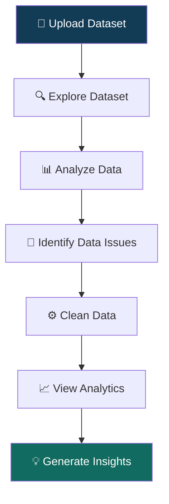

# ⚡ DataAnalysisStudio

<p align="center">
  
</p>

<p align="center">
  
  
  
  
</p>

<p align="center">
  
  
</p>

---

## 🚀 About The Project

**DataAnalysisStudio** is a web-based data analysis application built to make data analysis and data cleaning easier.

The project aims to bring essential data analysis operations into one interactive platform, helping users explore datasets, identify data quality problems, clean information and understand their data.

The goal is simple:

> Transform raw datasets into clean, structured and meaningful information.

## ✨ Features

| Feature | Description |
|:---|:---|
| 📂 Dataset Upload | Upload datasets for analysis |
| 🔍 Data Profiling | Explore rows, columns and data types |
| 🧹 Data Cleaning | Identify and handle data quality issues |
| 🔢 Numeric Cleaning | Handle numeric formatting and negative values |
| 🔣 Text Cleaning | Detect unwanted characters and inconsistent text |
| 📊 Analytics Dashboard | Explore data through visual summaries |
| 🔄 Dataset Switching | Change the uploaded dataset |
| 📁 Data Export | Support for exporting processed data |

*Note: Features are under active development. Availability may vary by version.*

## 🛠️ Tech Stack

<p align="center">
  
</p>

| Technology | Purpose |
|:---|:---|
| Python | Backend programming |
| FastAPI | API development |
| Pandas | Data manipulation |
| NumPy | Numerical operations |
| HTML5 | Web structure |
| CSS3 | Styling and layout |
| JavaScript | Frontend interactions |
| Git & GitHub | Version control |

## 🏗️ Project Structure

```text
DataAnalysisStudio/
│
├── backend/
│   ├── __init__.py
│   ├── main.py
│   └── requirements.txt
│
├── frontend/
│   ├── index.html
│   ├── style.css
│   └── app.js
│
├── README.md
└── .gitignore
```

## ⚙️ Installation Guide

### 1. Clone Repository

```bash
git clone https://github.com/deepanshupunjabi/DataAnalysisStudio.git
```

### 2. Open Project Folder

```bash
cd DataAnalysisStudio
```

### 3. Create Virtual Environment

```bash
python -m venv .venv
```

### 4. Activate Environment

**Windows PowerShell:**

```powershell
.\.venv\Scripts\Activate.ps1
```

### 5. Install Dependencies

```bash
pip install -r backend/requirements.txt
```

### 6. Start Application

```bash
uvicorn backend.main:app --reload
```

### 7. Open in Browser

```text
http://127.0.0.1:8000
```

## 🔄 How It Works



## 🗺️ Development Roadmap

- [x] Initial project structure
- [x] FastAPI backend setup
- [x] Frontend dashboard
- [x] Dataset upload workflow
- [x] Initial analytics functionality
- [ ] Advanced data profiling
- [ ] Intelligent cleaning recommendations
- [ ] AI-powered business insights
- [ ] Advanced data visualization
- [ ] Excel and PDF reporting
- [ ] Cloud deployment

## 📸 Screenshots

Screenshots of the application will be added here as development progresses.

<!-- Add screenshots when available -->

## 🔮 Future Vision

The long-term vision of DataAnalysisStudio is to develop an intelligent data analysis platform that can:

- Understand datasets automatically.
- Detect data quality problems.
- Recommend appropriate cleaning operations.
- Generate meaningful analytical reports.
- Help users discover business insights.

## 🤝 Contributing

Contributions, suggestions and ideas are welcome!

1. Fork this repository.
2. Create a new branch.
3. Make your changes.
4. Submit a Pull Request.

## 👨‍💻 Developer

<p align="center">
  <b>Deepanshu Punjabi</b><br/>
  Aspiring Data Analyst & Developer
</p>

<p align="center">
  <a href="https://github.com/deepanshupunjabi">
    
  </a>
</p>

---

<p align="center">
  
</p>

<h3 align="center">⚡ Analyze Smarter. Clean Better. Discover More.</h3>

<p align="center">If you like this project, consider giving it a ⭐</p>
